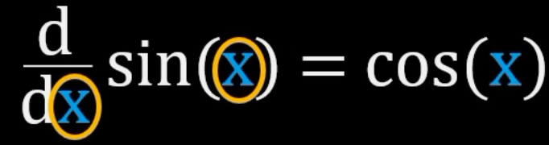
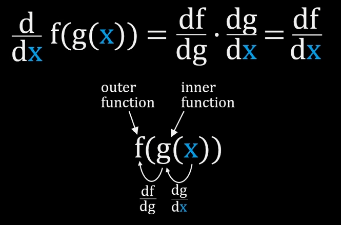
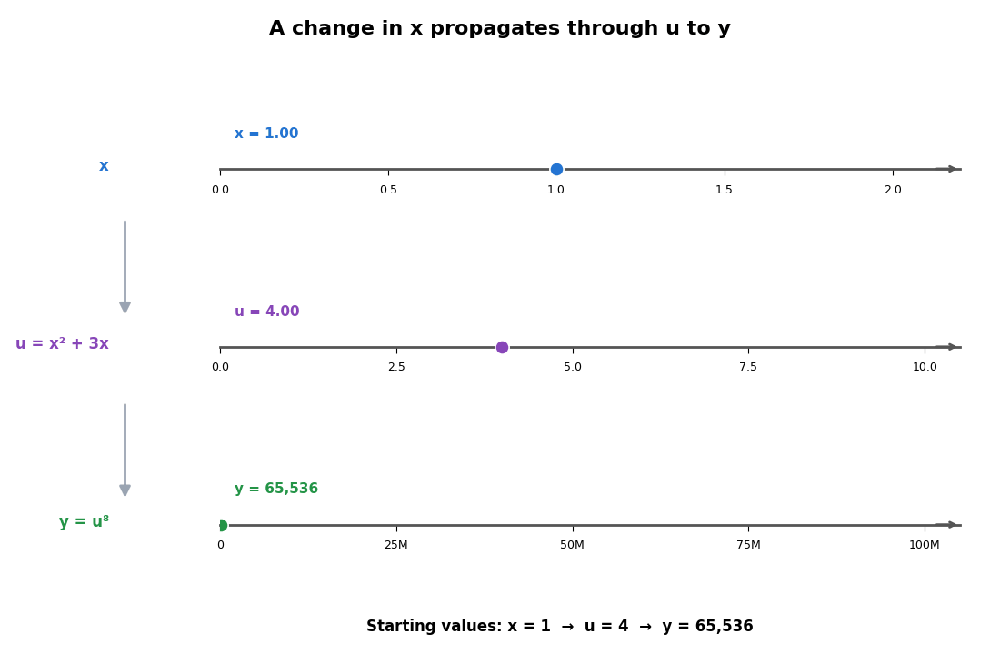
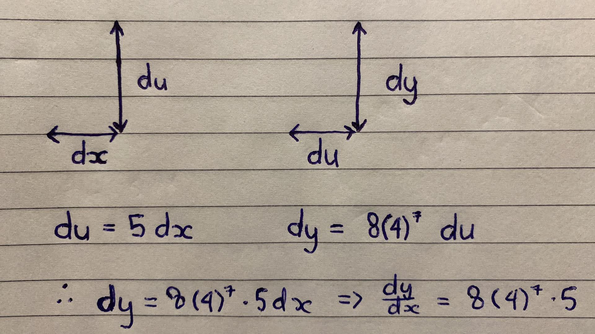
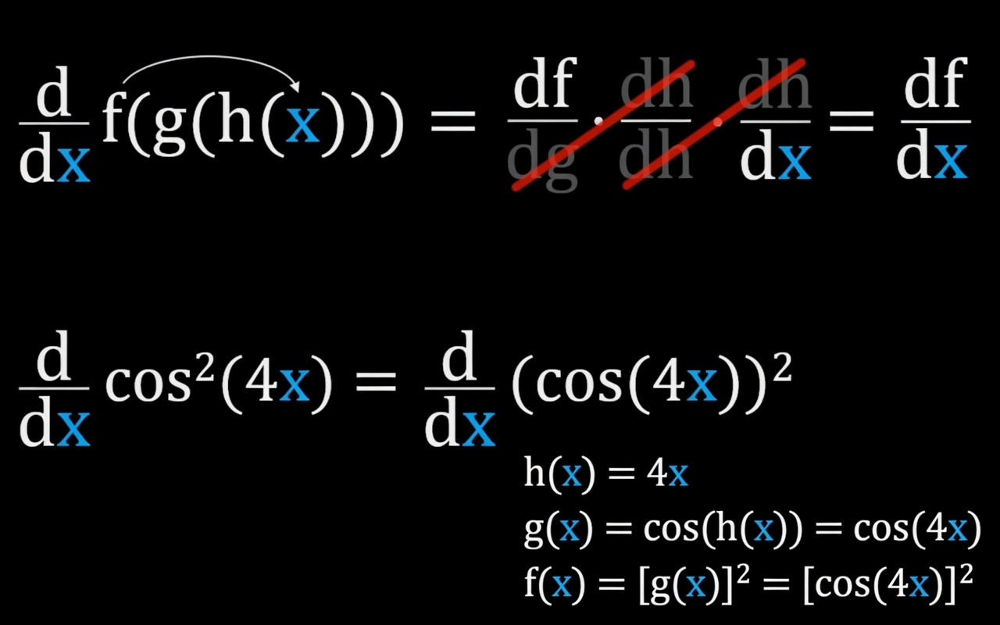

<div align='center'>
    <h1> Chain Rule </h1>
</div>

It is true that,

```math
\frac{d}{dx}\sin(x)=\cos(x)
```

However, suppose we are given,

```math
f(x)=\sin(2x)
```

It would be incorrect to assume that,

```math
\frac{d}{dx}\sin(2x)=\cos(2x)
```

The reason is that the expression inside the sine function is $2x$, but we are differentiating with respect to $x$. The familiar differentiation rule tells us that the derivative of the sine of an expression, with respect to that same expression, is the cosine of that expression. The expression being differentiated and the variable of differentiation must therefore be accounted for correctly.

<div align='center'>
    
</div>

To understand this distinction, we can introduce an intermediate variable,

```math
u=2x
```

Our original function can now be expressed as,

```math
f(u)=\sin(u)
```

Differentiating this function with respect to its input $u$ gives,

```math
\frac{df}{du}=\cos(u)
```

This derivative describes how the output of the sine function changes in response to a change in its input $u$. Since we defined $u=2x$, there is nothing wrong with substituting $2x$ into the derivative expression $\cos(u)$,

```math
\left.\frac{df}{du}\right|_{u=2x}=\cos(2x)
```

However, **we must be careful about what this result represents**. We have evaluated the outer derivative at the input $u=2x$, but we have not changed the variable with respect to which we differentiated. The result is still the derivative of $f$ with respect to $u$, **not the derivative of the complete function with respect to $x$**, despite us expressing this in terms of $2x$. In other words, $\cos(2x)$ tells us how quickly the output changes in response to a change in the input $u$. **It does not yet account for how quickly $u$ itself changes in response to a change in $x$**.

To find the derivative with respect to $x$, we must also differentiate the intermediate variable:

```math
\frac{du}{dx}=2
```

The chain rule combines these two rates of change:

```math
\begin{aligned}
\frac{df}{dx}
&=\left.\frac{df}{du}\right|_{u=2x}\cdot\frac{du}{dx}\\
&=\cos(2x)\cdot2\\
&=2\cos(2x)
\end{aligned}
```

The important distinction is that there is nothing wrong with substituting $u=2x$ into $\cos(u)$. What would be wrong is treating the result, $\cos(2x)$, as the complete derivative with respect to $x$. We have only evaluated the outer derivative; we still need to account for how the input changes with respect to $x$. This is the purpose of the **chain rule**.

To be explicit in every step,

##### 1. Define the intermediate variable
```math
u=2x
```

Differentiate with respect to $x$,
```math
\frac{du}{dx}=2
```

This tells us how quickly $u$ changes as $x$ changes.

##### 2. Define the generic outer function
```math
f(t)=\sin(t)
```

Here, $t$ is simply a placeholder representing the input to the function.

##### 3. Supply the actual input

Since our intermediate variable is $u=2x$, we supply $u$ as the input to the function,

```math
f(u)=\sin(u)
```

##### 4. Differentiate the outer function

Differentiate with respect to its input $u$,

```math
\frac{df}{du}=\cos(u)
```

This describes how quickly the output of $f$ changes with respect to its input $u$.

##### 5. Substitute the actual input into the derivative
Because $u=2x$, we can substitute $2x$ into the derivative expression,

```math
\left.\frac{df}{du}\right|_{u=2x}
=\cos(u)=\cos(2x)
```

This is still the outer derivative, $\frac{df}{du}$. We have simply evaluated it at the input $u=2x$. We have not yet calculated the rate of change with respect to $x$.

##### 6. Apply the chain rule
We want the rate of change of the complete function with respect to $x$. Therefore, we multiply by the rate at which the intermediate input changes,

```math
\begin{aligned}
\frac{df}{dx}
&=\frac{df}{du}\frac{du}{dx}\\
&=\cos(2x)\cdot 2\\
&=2\cos(2x)
\end{aligned}
```

## Composite functions

Many functions are not formed from a single operation, but instead contain multiple layers of functions nested inside one another. These are known as **composite functions**. A composite function occurs when the output of one function becomes the input of another function. The chain rule is used whenever one function is applied to the output of another function. A general composite function is written as,

```math
f(g(x))
```

where,

- $g(x)$ is called the inner function.
- $f$ is called the outer function.

The chain rule describes how derivatives behave when functions are composed together. It is written as,

```math
\boxed{\frac{d}{dx}f(g(x))=f'(g(x))\cdot g'(x)}
```

<div align='center'>
    
</div>

This multiplication may appear confusing because function composition itself is not multiplication. When functions are composed, the output of one function is substituted into another function. However, derivatives describe how quickly the output of a function changes in response to changes in its input. When functions are composed, changes propagate through each stage. The chain rule accounts for this by multiplying the rates of change at each stage.

There are two primary approaches to applying the chain rule:

1. **Direct function notation:** Define the inner and outer functions, then apply the chain rule using function notation.
2. **Leibniz notation:** Introduce intermediate variables to express the composition in terms of derivatives with respect to each intermediate variable.

Both approaches describe the same mathematical relationship. The difference is simply how we represent the functions and their derivatives.

## Intermediate variables and the chain rule

When applying the chain rule using Leibniz notation, it is common to introduce an intermediate variable such as $u$. This allows us to separate a composite function into individual stages and examine how changes propagate through them.

Suppose we have,

```math
y=(x^2+3x)^8
```

The graph of this function is determined by the relationship between $x$ and $y$:

- $x$ is the horizontal axis.
- $y$ is the vertical axis.

The graph itself only contains these two axes. However, the internal structure of the function can be decomposed into stages by introducing an intermediate quantity.

Define,

```math
\begin{aligned}
u&=x^2+3x\\
y&=u^8
\end{aligned}
```

This decomposition creates the dependency chain,

```math
x\longrightarrow u\longrightarrow y
```

<div align='center'>
    
</div>

It is important to understand that $u$ is not a new graph axis. The graph is still entirely determined by the relationship between $x$ and $y$. The variable $u$ is an intermediate quantity used to describe how changes propagate internally through the composite function. Changing $x$ changes $u$, and changing $u$ then changes $y$. The chain rule therefore studies how changes cascade through these intermediate stages.

Differentiating both stages gives,

```math
\begin{aligned}
\frac{du}{dx}&=2x+3\\
\frac{dy}{du}&=8u^7
\end{aligned}
```

Now suppose $x=1$. Then,

```math
u=1^2+3(1)=4
```

This means that at the point where $x=1$, the corresponding intermediate value is $u=4$. We can now evaluate the derivatives at this point.

First,

```math
\frac{du}{dx}=2(1)+3=5
```

This means that near $x=1$, a small change in $x$ produces a change in $u$ that is approximately five times as large. In terms of differentials,

```math
du=5\,dx
```

Next,

```math
\frac{dy}{du}=8u^7
```

At the point where $u=4$,

```math
\frac{dy}{du}=8(4)^7
```

This means that near $u=4$, a small change in $u$ produces a change in $y$ that is approximately $8(4)^7$ times as large. In terms of differentials,

```math
dy=8(4)^7\,du
```

The important conceptual step is that the change produced by the first stage becomes the input change for the second stage. Since,

```math
\begin{aligned}
du&=5\,dx\\
dy&=8(4)^7\,du\\
dy&=8(4)^7\cdot5\,dx
\end{aligned}
```

Therefore,

```math
\frac{dy}{dx}=8(4)^7\cdot5
```

<div align='center'>
    
</div>

The first derivative,

```math
\frac{du}{dx}
```

describes how changes in $x$ produce changes in $u$. The second derivative,

```math
\frac{dy}{du}
```

describes how changes in $u$ scale into changes in $y$. Because the output change from the first stage becomes the input change for the second stage, the scaling factors multiply together. This produces the chain rule relationship:

```math
\boxed{\frac{dy}{dx}=\frac{dy}{du}\cdot\frac{du}{dx}}
```

This relationship occurs because a change in $x$ produces a change in $u$, which in turn produces a change in $y$.

##### Example 1 - $f(x)=\sin(2x)$

<p>
&nbsp;&nbsp;&nbsp;&nbsp;<strong>Direct function usage</strong>
</p>

First, identify the inner and outer functions:

```math
\begin{aligned}
g(x)  &= 2x &\qquad f(u) &= \sin(u) \\
g'(x) &= 2   &\qquad f'(u) &= \cos(u)
\end{aligned}
```

The dependency chain is:

```math
x\longrightarrow g(x)=2x
\longrightarrow f(g(x))=\sin(2x)
```

Applying the chain rule:

```math
f'(g(x))\cdot g'(x)
= \cos(2x)\cdot 2
= 2\cos(2x)
```

We can also express this using Leibniz notation for the two functions. When we differentiate $f$ with respect to its input $g$,

```math
\frac{df}{dg}
=\frac{d}{dg}\sin(g)
=\cos(g)
```

We then evaluate this derivative at the output of the inner function, $g(x)=2x$,

```math
\left.\frac{df}{dg}\right|_{g=2x}
=\cos(2x)
```

Therefore,

```math
\begin{aligned}
\frac{df}{dx}
&= \frac{df}{dg}\cdot\frac{dg}{dx}\\
&= \cos(g)\cdot 2\\
&= \cos(2x)\cdot 2\\
&= 2\cos(2x)
\end{aligned}
```

Here, $\frac{dg}{dx}$ describes how the inner function changes with $x$, while $\frac{df}{dg}$ describes how the outer function changes with its input $g$. Multiplying them gives the overall rate of change of the composite function with respect to $x$.

**A notation qualification:** $\frac{df}{dg}$ is being used here as shorthand for the outer derivative with respect to its input, evaluated at $g=g(x)$. This is an explanatory use of Leibniz notation; the more conventional formal presentation introduces an intermediate variable $u$.

<p>
&nbsp;&nbsp;&nbsp;&nbsp;<strong>Leibniz notation</strong>
</p>

```math
\begin{aligned}
u &= 2x &\qquad y &= \sin(u) \\
\frac{du}{dx} &= 2 &\qquad \frac{dy}{du} &= \cos(u)
\end{aligned}
```

```math
\frac{dy}{dx}
= \frac{dy}{du}\frac{du}{dx}
= \cos(2x)\cdot 2
= 2\cos(2x)
```

##### Example 2 - $y = (3x + 1)^5$

<p>
&nbsp;&nbsp;&nbsp;&nbsp;<strong>Direct function usage</strong>
</p>

```math
\begin{aligned}
g(x)  &= 3x + 1 &\qquad f(u) &= u^5 \\
g'(x) &= 3      &\qquad f'(u) &= 5u^4
\end{aligned}
```

```math
f'(g(x))\cdot g'(x)
= 5(3x+1)^4\cdot 3
= 15(3x+1)^4
```

<p>
&nbsp;&nbsp;&nbsp;&nbsp;<strong>Leibniz notation</strong>
</p>

```math
\begin{aligned}
u &= 3x + 1 &\qquad y &= u^5 \\
\frac{du}{dx} &= 3 &\qquad \frac{dy}{du} &= 5u^4
\end{aligned}
```

```math
\frac{dy}{dx}
= \frac{dy}{du}\frac{du}{dx}
= 5(3x+1)^4\cdot 3
= 15(3x+1)^4
```

##### Example 3 - $y = \sqrt{1+x^3} = (1+x^3)^{1/2}$

<p>
&nbsp;&nbsp;&nbsp;&nbsp;<strong>Direct function usage</strong>
</p>

```math
\begin{aligned}
g(x) &= 1+x^3 &\qquad f(u) &= u^{1/2} \\
g'(x) &= 3x^2 &\qquad f'(u) &= \frac12u^{-1/2}
\end{aligned}
```

```math
f'(g(x))\cdot g'(x)
= \frac12(1+x^3)^{-1/2}\cdot 3x^2
= \frac{3x^2}{2\sqrt{1+x^3}}
```

<p>
&nbsp;&nbsp;&nbsp;&nbsp;<strong>Leibniz notation</strong>
</p>

```math
\begin{aligned}
u &= 1+x^3 &\qquad y &= u^{1/2} \\
\frac{du}{dx} &= 3x^2 &\qquad \frac{dy}{du} &= \frac12u^{-1/2}
\end{aligned}
```

```math
\frac{dy}{dx}
= \frac{dy}{du}\frac{du}{dx}
= \frac12(1+x^3)^{-1/2}\cdot 3x^2
= \frac{3x^2}{2\sqrt{1+x^3}}
```

## Comprehensive - Understanding the Chain Rule

##### Example 1 — $y = (x + 1)^2$

When observing

```math
y = (x + 1)^2
```

there are actually two operations happening.

1. Start with $x$
2. Add $1$ to get $x + 1$
3. Square the result

```math
x \xrightarrow{+1} x+1 \xrightarrow{\text{squared}} (x+1)^2
```

We can write this as,

```math
\begin{align*}
u &= x + 1 \\
y &= u^2
\end{align*}
```

Hence,

```math
x \xrightarrow{\frac{du}{dx}} u \xrightarrow{\frac{dy}{du}} y \\
\frac{dy}{dx} = \frac{du}{dx} \cdot \frac{dy}{du}
```

This means,

1. As $x$ changes, $u$ changes with respect so $x$ at a rate of $\frac{du}{dx}$
2. Moving forward, as $u$ changes, $y$ changes with respect to $u$ at a rate of $\frac{dy}{du}$

It therefore follows,

```math
\begin{align*}
\frac{du}{dx} &= 1 \\
\frac{dy}{du} &= 2(x+1) \\[6pt]
du &= 1 \cdot dx \\
dy &= 2(x+1)\,du \\
dy &= 2(x+1)\cdot 1 \cdot dx \\
dy &= 2(x+1)\,dx \\
\frac{dy}{dx} &= 2(x+1)
\end{align*}
```

##### Example 2 — $y = \sin(x^2)$

When observing

```math
y = \sin(x^2)
```

there are actually two operations happening

1. Start with $x$
2. Square it to get $x^2$
3. Take the sine of the result

```math
x \xrightarrow{\text{squared}} x^2 \xrightarrow{\sin} \sin(x^2)
```

We can write this as,

```math
\begin{aligned}
u &= x^2 \\
y &= \sin(u)
\end{aligned}
```

Hence,

```math
x \xrightarrow{\frac{du}{dx}} u \xrightarrow{\frac{dy}{du}} y \\
\frac{dy}{dx} = \frac{du}{dx} \cdot \frac{dy}{du}
```

This means,

1. As $x$ changes, $u$ changes with respect so $x$ at a rate of $\frac{du}{dx}$
2. Moving forward, as $u$ changes, $y$ changes with respect to $u$ at a rate of $\frac{dy}{du}$

It therefore follows,

```math
\begin{aligned}
\frac{du}{dx} &= 2x \\
\frac{dy}{du} &= \cos(u) \\
du &= 2x \, dx \\
dy &= \cos(u)\, du \\
dy &= \cos(u)\cdot 2x \, dx \\
\frac{dy}{dx} &= 2x \cos(u) \\
\frac{dy}{dx} &= 2x \cos(x^2)
\end{aligned}
```

#### Multiple Functions

This can also expand to more complicated scenarios where we get more terms, but the idea remains the same.

<div align='center'>
    
</div>

Consider the function

```math
y = \cos^2(4x)
```

Now, break it down into separate variables.

```math
\begin{aligned}
h(x) &= 4x \\
g(u) &= \cos(u) \\
f(v) &= v^2
\end{aligned}
```

which gives

```math
f(g(h(x))) = \cos^2(4x)
```

This notation explicitly separates the function into a sequence of individual operations. Beginning with an input $x$,

```math
h(x) = 4x
```

multiplies the input by $4$. The result is then passed into,

```math
g(u) = \cos(u)
```

which applies the cosine function. Finally,

```math
f(v) = v^2
```

squares the result. The complete process can therefore be visualized as,

```math
x \to u \to v \to y
```

where

```math
\begin{aligned}
u &= h(x) \\
v &= g(u) \\
y &= f(v)
\end{aligned}
```

The important observation is that each stage produces a new quantity which becomes the input of the next stage. This interpretation is often the most natural way to understand the chain rule because it exposes every intermediate step. Each quantity depends only on the quantity immediately before it. We may therefore ask three independent questions,

First,

```math
u = 4x
```

How rapidly does $u$ change with respect to $x$?

```math
\frac{du}{dx} = 4
```

Second,

```math
v = \cos(u)
```

How rapidly does $v$ change with respect to $u$?

```math
\frac{dv}{du} = -\sin(u)
```

Third,

```math
y = v^2
```

How rapidly does $y$ change with respect to $v$?

```math
\frac{dy}{dv} = 2v
```

Notice that these derivatives are not introduced arbitrarily. Each one simply measures the rate of change between two neighbouring stages of the composition. The chain rule states that the overall rate of change from $x$ to $y$ is obtained by multiplying the rates of change at each stage.

```math
\frac{dy}{dx} = \frac{dy}{dv} \cdot \frac{dv}{du} \cdot \frac{du}{dx}
```

Substituting the derivatives gives,

```math
\frac{dy}{dx} (2v)(-\sin(u))(4)
```

which produces

```math
\frac{dy}{dx} = 2\cos(4x)(-\sin(4x))(4) = -8\cos(4x)\sin(4x)
```

##### Example 1 - Function Composite View

Let,

```math
y = (x^2 + 1)^3
```

Observing the expression, it appears that the power rule could potentially be used because their is an exponent of $3$. But the subtle issue is that the thing being cubed is not simply $x$. This is where the chain rule is used.

This expression contains two nested functions. Define the inner function as

```math
g(x) = x^2 + 1
```

and define the outer function as

```math
f(u) = u^3
```

The original function can now be viewed as,

```math
y = f(g(x))
```

The chain rule now be easier to apply. First, differentiate both equations.

```math
\begin{aligned}
g'(x) &= 2x \\
f'(u) &= 3u^2
\end{aligned}
```

The chainrule therefore states,

```math
\begin{aligned}
\frac{d}{dx} f(g(x))
&= 3(x^2 + 1)^2 \cdot 2x \\
\\
\frac{d}{dx} f(g(x))
&= 6x(x^2 + 1)^2
\end{aligned}
```

##### Example 2 - Function Composite View with Leibniz Notation

Let,

```math
y = (x^2 + 3x)^8
```

First perform a substitution,

```math
\begin{aligned}
u &= x^2 + 3x
\\

\frac{du}{dx} &= 2x + 3
\end{aligned}
```

Which follows,

```math
\begin{aligned}
y &= u^8
\\

\frac{dy}{du} &= 8u^7
\end{aligned}
```

Therefore,

```math
\frac{dy}{dx} = \frac{dy}{du} \cdot \frac{du}{dx} = 8u^7 \cdot (2x + 3) = 8(x^2 + 3x)^7 (2x + 3)
```

##### Example 3 - Substitution and the Power Rule

As an illustrative example, we can perform substitution to use the power rule and compare this to using the chain rule.

Given,

```math
y = (x^2 + 1)^3
```

we define a temporary variable,

```math
z = x^2 + 1
```

The function now becomes $y = z^3$. At this stage, the ordinary power rule can be applied directly.

```math
\begin{aligned}
y &= z^3 \\
\frac{dy}{dz} &= 3z^2
\end{aligned}
```

Differentiating $z = x^2 + 1$ gives

```math
\frac{dz}{dx} = 2x
```

The total rate of change of $y$ with respect to $x$ must therefore include both stages of change.

1. How $y$ changes with respect to $z$
2. How $z$ changes with respect to $x$

The chain rule combines these together.

```math
\frac{dy}{dx} = \frac{dy}{dz} \cdot \frac{dz}{dx}
```

It therefore follows,

```math
\begin{aligned}
3z^2 \cdot 2x \,
\frac{dy}{dz}
\cdot
\frac{dz}{dx}
\\

3z^2 \cdot 2x \,
\frac{dy}{\cancel{dz}}
\cdot
\frac{\cancel{dz}}{dx}
\\

3z^2 \cdot 2x \,
\frac{dy}{dx}
\\

3(x^2 + 1)^2 \cdot 2x \,
\frac{dy}{dx}
\\

6x(x^2 + 1)^2 \,
\frac{dy}{dx}
\end{aligned}
```

<div align='center'>
    <h1> Algebraic Proof </h1>
</div>

Given $y = f(g(x))$

```math
\begin{aligned}
\frac{dy}{dx}

&= \lim_{h \rightarrow 0} \frac{f(x + h) - f(x)}{h} \\

&= \lim_{h \to 0} \frac{f(g(x + h)) - f(g(x))}{h} \\

&= \lim_{h \to 0}
\frac{f(g(x + h)) - f(g(x))}{h}
\cdot
\frac{g(x+h) - g(x)}{g(x+h) - g(x)} \\

&= \lim_{h \to 0}
\frac{f(g(x + h)) - f(g(x))}{g(x+h) - g(x)}
\cdot
\frac{g(x+h) - g(x)}{h} \\

&= \left(
\lim_{h \to 0}
\frac{f(g(x + h)) - f(g(x))}{g(x+h) - g(x)}
\right)
\cdot
\left(
\lim_{h \to 0}
\frac{g(x+h) - g(x)}{h}
\right) \\

&=
\lim_{h \to 0}
\frac{f(g(x + h)) - f(g(x))}{g(x+h) - g(x)}
\cdot g'(x)
\end{aligned}
```

Now, we introduce a new variable.

```math
\begin{aligned}
k &= g(x+h) - g(x) \\
g(x+h) &= g(x) + k
\end{aligned}
```

When I write $k = g(x + h) - g(x)$, the value of $k$ depends on whatever value of $h$ you choose (with $x$ fixed). So more formally, $k$ is not an independent variable. Instead, it is a function of $h$,

```math
k(h) = g(x + h) - g(x)
```

Because $g$ is differentiable, it is continuous, so as $h \to 0$, we have $k \to 0$.

```math
\lim_{h \to 0} k = \lim_{h \to 0} g(x + h) - g(x) = 0
```

Because every value of $k$ near $0$ corresponds to some $h$ near $0$, the limit of $h$ approaches $0$ is the same limit as $k$ approaches $0$ of the new expression.

```math
\lim_{h \to 0} \frac{f(g(x+h)) - f(g(x))}{g(x+h)-g(x)} = \lim_{k \to 0} \frac{f(g(x)+k) - f(g(x))}{k}
```

It therefore follows,

```math
\begin{aligned}
\frac{dy}{dx}


&=
\lim_{h \to 0}
\frac{f(g(x + h)) - f(g(x))}{g(x+h) - g(x)}
\cdot g'(x) \\

&= \lim_{k \to 0} \frac{f(g(x) + k) - f(g(x))}{k} \cdot g'(x) \\

&= f'(g(x)) \cdot g'(x) \\

\end{aligned}
```

In a complete form this is written as,

```math
\frac{dy}{dx} = \lim_{k \to 0} \frac{f(g(x) + k) - f(g(x))}{k} \cdot \lim_{h \to 0}
\frac{g(x+h) - g(x)}{h}
```
