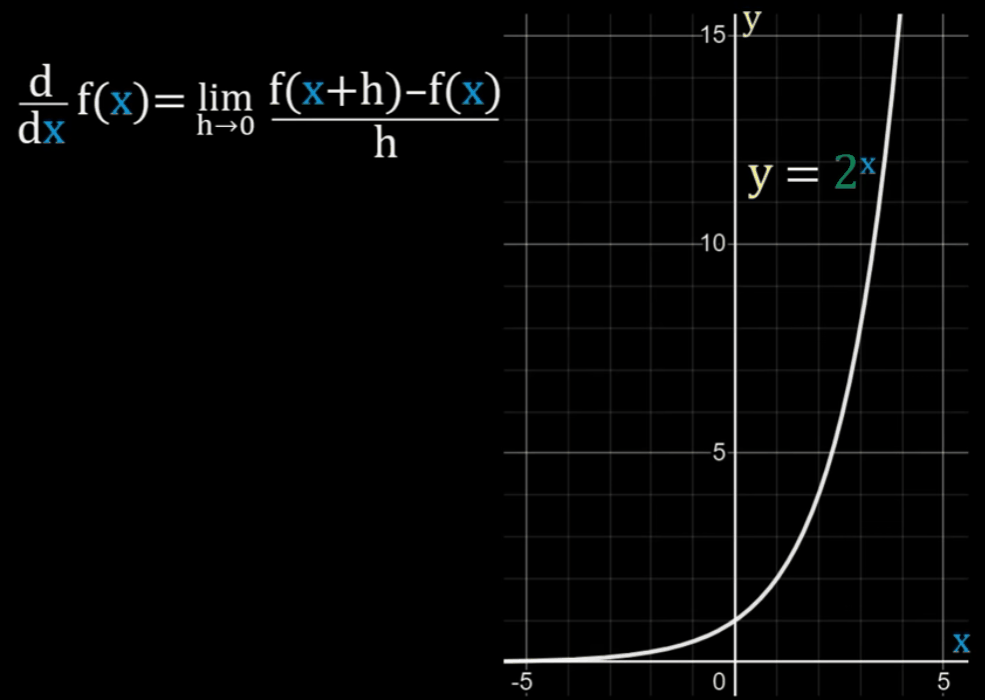

<div align='center'>
    <h1> Differentiation Rules for Exponents </h1>
</div>

We always refer to the definition of differentiation.

```math
\frac{d}{dx} f(x) = \lim_{h \rightarrow 0} \frac{f(x + h) - f(x)}{h}
```

<div align='center'>
    
</div>

Any exponential function is when $x$ is the exponent. Here, we will use

```math
y = 2^x
```

in our example. Proceeding to substitute it into our question,

```math
\begin{aligned}
\frac{d}{dx} 2^x &= \lim_{h \rightarrow 0} \frac{2^{(x + h)} - 2^x}{h} \\
                 &= \lim_{h \rightarrow 0} \frac{2^x 2^h - 2^x}{h} \\
                 &= \lim_{h \rightarrow 0} \frac{2^x(2^h - 1)}{h} \\
                 &= 2^x \lim_{h \rightarrow 0} \frac{2^h - 1}{h} \\
\end{aligned}
```

Because,

```math
\lim_{h \rightarrow 0} \frac{a^h - 1}{h} = \ln(a)
```

It follows,

```math
\frac{d}{dx} 2^x = 2^x \cdot \ln(2)
```

We can therefore generalize this to become,

```math
\boxed{\frac{d}{dx} b^x = \ln(b) \cdot b^x}
```

This allows us to see additional derivative properties of exponents with base $e$,

```math
\frac{d}{dx} e^x = \ln e \cdot e^x
```

Because 

```math
\ln e = \log_ e e = 1
```

Therefore,

```math
\boxed{\frac{d}{dx} e^x = e^x}
```

It's very important to reinforce that

```math
\frac{d}{dx} b^x = \ln(b) \cdot b^x
```

applies when the **independent variable is the exponent**, not to be confused with the power rule

```math
\frac{d}{dx} x^n = n \cdot x^{n - 1}
```

which applies when the **independent variable is the base**. Keep in mind when differentiating exponents, requiring use of the **chain rule**,

```math
\frac{d}{dx} b^{f(x)} = b^{f(x)} \cdot \ln b \cdot f'(x)
```


<div style="margin-left: 2em;"><strong>Direct function usage</strong></div>

```math
x \rightarrow f(x) \rightarrow b^{f(x)}
```

```math
\begin{aligned}
g(x) &= f(x) \qquad &g'(x) = f'(x) \\
f(u) &= b^u  \qquad  &f'(u) = b^u \cdot \ln b
\end{aligned}
```

```math
\frac{d}{dx} f(g(x)) = f'(g(x)) \cdot g'(x) = b^{f(x)} \cdot \ln b \cdot f'(x)
```

<div style="margin-left: 2em;"><strong>Leibniz notation </strong></div>

```math
\begin{aligned}
u &= f(x)              \qquad &y = b^u \\
\frac{du}{dx} &= f'(x) \qquad &\frac{dy}{du} = b^u \cdot \ln b 
\end{aligned}
```

```math
\frac{dy}{dx} = \frac{dy}{du} \frac{du}{dx} = b^{f(x)} \cdot \ln b \cdot f'(x)
```

<div align='center'>
    <h1> Extended Proof </h1>
</div>

Above, I explicitly said,

```math
\ln(a) = \lim_{h \rightarrow 0} \frac{a^h - 1}{h}
```

as a core part of the proof. Let,

```math
f(x) = a^x
```

We want to find $f'(x)$. From the definition of a derivative,

```math
f'(x) = \lim_{h \rightarrow 0} \frac{f(x + h) - f(x)}{h}
```

Substitute $f(x) = a^x$.

```math
\begin{aligned}
f'(x) &= \lim_{h \rightarrow 0} \frac{a^{x + h} - a^x}{h} \\
      &= \lim_{h \rightarrow 0} \frac{a^xa^h -a^x}{h} \\
      &= \lim_{h \rightarrow 0} \frac{a^x(a^h -1)}{h} \\
      &= a^x \lim_{h \rightarrow 0} \frac{a^h -1}{h} \\
\end{aligned}
```

Now look carefully at this part,

```math
\lim_{h \rightarrow 0} \frac{a^h - 1}{h}
```

Remember our function $f(x) =a^x$, the derivative at $x=0$, from the definition of a derivative is,

```math
\begin{aligned}
f'(0) &= \lim_{h \rightarrow 0} \frac{f(0 + h) -f(0)}{h} \\
      &= \lim_{h \rightarrow 0} \frac{a^{0 + h} - a^0}{h} \\
      &= \lim_{h \rightarrow 0} \frac{a^h - 1}{h} \\
\end{aligned}
```

Therefore,

```math
f'(0) = \lim_{h \rightarrow 0} \frac{a^h -1}{h}
```

for the equation $f(x) = a^x$. Now we can go back to where we were,

```math
\begin{aligned}
f'(x) &= a^x \lim_{h \rightarrow 0} \frac{a^h - 1}{h} \\
      &= a^x f'(0)
\end{aligned}
```

We have now established, $f'(x) = a^x f'(0)$. Now, we need to find $f'(0)$. This is where logarithm enters. The standard relationship between $a^x$ and $e^x$ is,

```math
\begin{aligned}
a^x &= a^x \\
    &= e^{\ln(a^x)} \\
    &= e^{x \cdot \ln(a)} \\
\end{aligned}
```

So our function can be written as,

```math
f(x) = e^{x \cdot \ln(a)}
```

We now differentiate this using the chain rule.

```math
\begin{aligned}
u &= x \cdot \ln(a) &\qquad \text{Inner Function} \\
y &= e^u &\qquad \text{Outer Function}
\end{aligned}
```

So we can write,

```math
y = e^u
```

Now we differentiate,

```math
\begin{aligned}
\frac{du}{dx} &= \ln(a) \qquad \text{Remember } \ln(a) \text{ is a constant} \\
\frac{dy}{du} &= e^u
\end{aligned}
```

Therefore,

```math
\begin{aligned}
\frac{dy}{dx} = \frac{dy}{du} \frac{du}{dx} &= e^u \cdot \ln(a) \\
                                            &= e^{x \cdot \ln(a)} \cdot \ln(a)
\end{aligned}
```

Therefore,

```math
\begin{aligned}
\frac{dy}{dx} &= e^{x \cdot \ln(a)} \cdot \ln(a) \\
              &= a^x \cdot \ln(a) \qquad \text{Substituting back}
\end{aligned}
```

Therefore,

```math
\frac{dy}{dx} a^x = a^x \cdot \ln(a)
```

We want $f'(0)$. Therefore,

```math
\begin{aligned}
f'(0) &= a^0 \cdot \ln(a) \\
      &= \ln(a)
\end{aligned}
```

Earlier we established,

```math
\begin{aligned}
f'(x) &= a^x f'(0) \\
      &= a^x \cdot \ln(a)
\end{aligned}
```

We can finally conclude,

```math
\boxed{\frac{dy}{dx} a^x = a^x \cdot \ln(a)}
```
