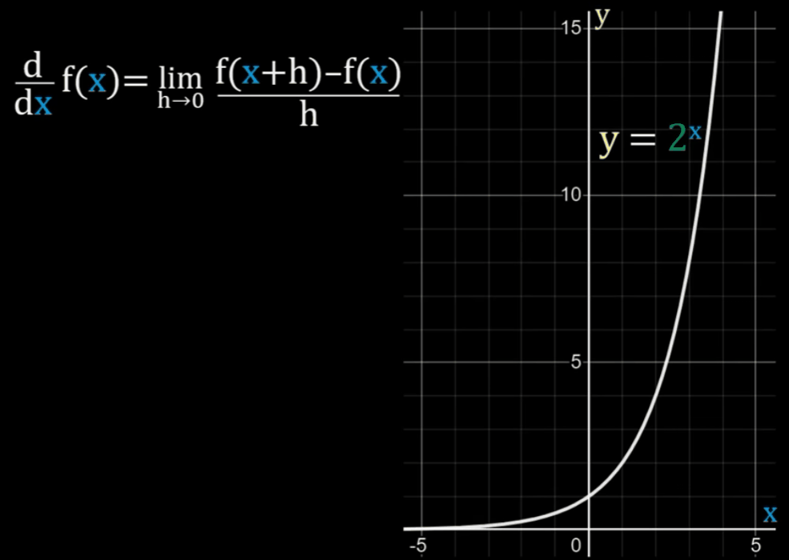
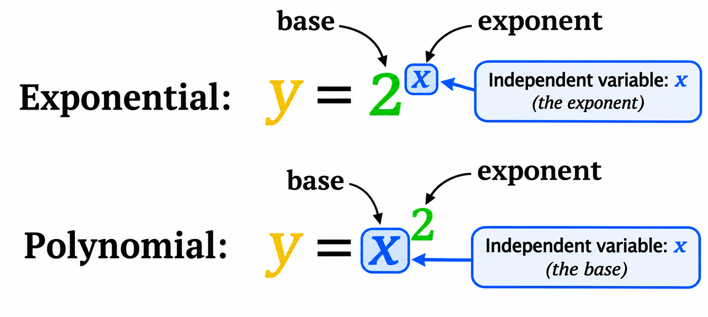

<div align='center'>
    <h1> Exponential Functions </h1>
</div>

We begin with the definition of differentiation,

```math
\frac{d}{dx}f(x)=\lim_{h\rightarrow 0}\frac{f(x+h)-f(x)}{h}
```

<div align='center'>
    
</div>

An **exponential function** is a function in which the independent variable appears in the exponent. For example, consider:

```math
y = \underset{\text{base}}{2}^{\overset{\text{exponent}}{x}}
```

It's very important to not mistake these for a polynomial function. These are different functions with different derivatives. A very simle way to remember this is that an exponential function has the independent variable in the exponent.

<div align='center'>
    
</div>

To differentiate this function, we substitute it into the definition of a derivative:

```math
\begin{aligned}
\frac{d}{dx}2^x
&=\lim_{h\rightarrow 0}\frac{2^{x+h}-2^x}{h}\\
&=\lim_{h\rightarrow 0}\frac{2^x\cdot 2^h-2^x}{h}\\
&=\lim_{h\rightarrow 0}\frac{2^x(2^h-1)}{h}\\
&=2^x\lim_{h\rightarrow 0}\frac{2^h-1}{h}
\end{aligned}
```

We can use the following limit identity, which will be established in the extended proof below,

```math
\lim_{h\rightarrow 0}\frac{a^h-1}{h}=\ln(a),\qquad a>0
```

Therefore,

```math
\frac{d}{dx}2^x=2^x\cdot\ln(2)
```

We can generalise this result to any positive constant base $b$:

```math
\boxed{\frac{d}{dx}b^x=b^x\cdot\ln(b)}
```

### Differentiating Exponential Functions with Base $e$

We can use this general rule to establish an important property of the natural exponential function,

```math
\frac{d}{dx}e^x=e^x\cdot\ln(e)
```

Since,

```math
\ln(e)=1
```

It follows that,

```math
\boxed{\frac{d}{dx}e^x=e^x}
```

This is a particularly useful property of the natural exponential function, **the derivative of $e^x$ is the function itself.**

### Applying the Chain Rule to Exponential Functions

It is important to distinguish between the exponential differentiation rule and the power rule.

The **exponential** differentiation rule,

```math
\frac{d}{dx}b^x=b^x\cdot\ln(b)
```

applies when the independent variable is the **exponent**, while the base is a constant.

In contrast, the **power rule**,

```math
\frac{d}{dx}x^n=n\cdot x^{n-1}
```

applies when the independent variable is the **base**, while the exponent is a constant.

When the exponent is itself a function of $x$, we must also apply the chain rule:

```math
\boxed{\frac{d}{dx}b^{f(x)}=b^{f(x)}\cdot\ln(b)\cdot f'(x)}
```

We can understand this through two approaches.

**Direct function composition**

Consider the following function composition,

```math
x\rightarrow f(x)\rightarrow b^{f(x)}
```

Let the inner function be $g(x)=f(x)$, and let the outer function be $F(u)=b^u$.

```math
\begin{aligned}
g(x)&=f(x) &\qquad g'(x)&=f'(x)\\
F(u)&=b^u &\qquad F'(u)&=b^u\cdot\ln(b)
\end{aligned}
```

Applying the chain rule,

```math
\begin{aligned}
\frac{d}{dx}F(g(x))
&=F'(g(x))\cdot g'(x)\\
&=b^{f(x)}\cdot\ln(b)\cdot f'(x)
\end{aligned}
```

**Leibniz notation**

Alternatively, we can express the same relationship using Leibniz notation.

Let,

```math
\begin{aligned}
u&=f(x) &\qquad y&=b^u\\
\frac{du}{dx}&=f'(x) &\qquad \frac{dy}{du}&=b^u\cdot\ln(b)
\end{aligned}
```

Applying the chain rule,

```math
\begin{aligned}
\frac{dy}{dx}
&=\frac{dy}{du}\cdot\frac{du}{dx}\\
&=b^u\cdot\ln(b)\cdot f'(x)\\
&=b^{f(x)}\cdot\ln(b)\cdot f'(x)
\end{aligned}
```

Both approaches produce the same result.

# Extended Proof

Earlier, we introduced the following limit identity as part of our derivation:

```math
\lim_{h\rightarrow 0}\frac{a^h-1}{h}=\ln(a)
```

We will now establish this identity by starting with the definition of a derivative and using the relationship between exponential and logarithmic functions.

Let:

```math
f(x)=a^x,\qquad a>0
```

We want to find $f'(x)$. Starting with the definition of a derivative:

```math
f'(x)=\lim_{h\rightarrow 0}\frac{f(x+h)-f(x)}{h}
```

Substituting $f(x)=a^x$:

```math
\begin{aligned}
f'(x)
&=\lim_{h\rightarrow 0}\frac{a^{x+h}-a^x}{h}\\
&=\lim_{h\rightarrow 0}\frac{a^x\cdot a^h-a^x}{h}\\
&=\lim_{h\rightarrow 0}\frac{a^x(a^h-1)}{h}\\
&=a^x\lim_{h\rightarrow 0}\frac{a^h-1}{h}
\end{aligned}
```

Notice that we can express the remaining limit in terms of the derivative of our original function at $x=0$.

### Finding the Derivative at $x=0$

Using the definition of a derivative at $x=0$:

```math
\begin{aligned}
f'(0)
&=\lim_{h\rightarrow 0}\frac{f(0+h)-f(0)}{h}\\
&=\lim_{h\rightarrow 0}\frac{a^{0+h}-a^0}{h}\\
&=\lim_{h\rightarrow 0}\frac{a^h-1}{h}
\end{aligned}
```

Therefore, we have established that:

```math
f'(0)=\lim_{h\rightarrow 0}\frac{a^h-1}{h}
```

Returning to our earlier expression for $f'(x)$:

```math
\begin{aligned}
f'(x)
&=a^x\lim_{h\rightarrow 0}\frac{a^h-1}{h}\\
&=a^x f'(0)
\end{aligned}
```

We have now established an important relationship:

```math
\boxed{f'(x)=a^x f'(0)}
```

To complete the proof, we need to determine the value of $f'(0)$.

### Finding $f'(0)$ Using the Natural Exponential Function

Recall the relationship between exponential and logarithmic functions:

```math
a^x=e^{\ln(a^x)}
```

Using the logarithm power rule:

```math
\begin{aligned}
a^x
&=e^{\ln(a^x)}\\
&=e^{x\ln(a)}
\end{aligned}
```

Therefore, we can rewrite our original function as:

```math
f(x)=e^{x\ln(a)}
```

We can now differentiate this expression using the chain rule.

Let:

```math
\begin{aligned}
u&=x\ln(a) &\qquad&\text{Inner function}\\
y&=e^u &&\text{Outer function}
\end{aligned}
```

Differentiating both functions:

```math
\begin{aligned}
\frac{du}{dx}&=\ln(a)\\
\frac{dy}{du}&=e^u
\end{aligned}
```

Remember that $\ln(a)$ is a constant because $a$ is a constant.

Applying the chain rule:

```math
\begin{aligned}
\frac{dy}{dx}
&=\frac{dy}{du}\cdot\frac{du}{dx}\\
&=e^u\cdot\ln(a)\\
&=e^{x\ln(a)}\cdot\ln(a)
\end{aligned}
```

Substituting back into our original exponential expression:

```math
\boxed{\frac{dy}{dx}=a^x\cdot\ln(a)}
```

We have therefore established the derivative of $a^x$.

To find $f'(0)$, simply substitute $x=0$:

```math
\begin{aligned}
f'(0)
&=a^0\cdot\ln(a)\\
&=\ln(a)
\end{aligned}
```

### Final Result

Earlier, we established that:

```math
f'(x)=a^x f'(0)
```

Substituting $f'(0)=\ln(a)$:

```math
\begin{aligned}
f'(x)&=a^x\cdot\ln(a)
\end{aligned}
```

We can finally conclude:

```math
\boxed{\frac{d}{dx}a^x=a^x\cdot\ln(a)}
```