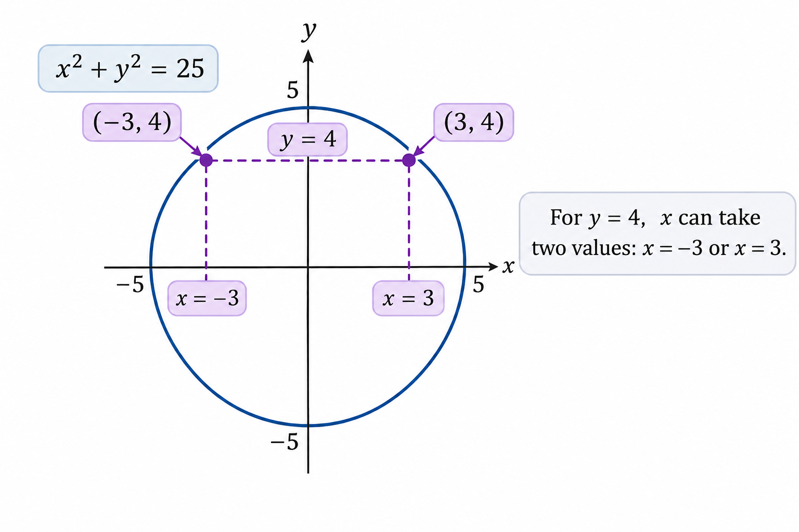
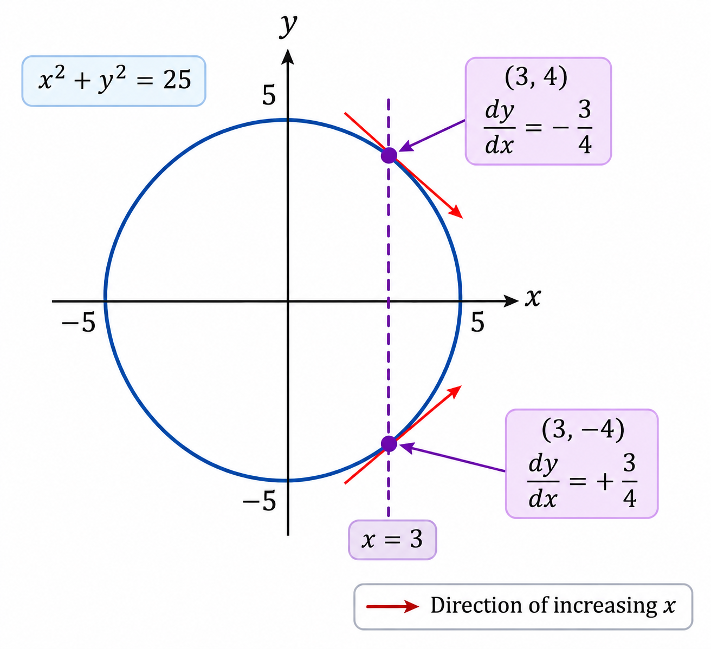

<div align='center'>
    <h1> Implicit Differentiaton </h1>
</div>

Differentiation allows us to determine how one quantity changes in response to changes in another. When a relationship is written explicitly, such as $y=x^2$, we can differentiate the expression on the right-hand side to find $\frac{dy}{dx}=2x$. However, some relationships are not written in this form. For example, a circle can be represented by the equation $x^2+y^2=25$. Here, $x$ and $y$ are related, but $y$ has not been isolated as a single expression in terms of $x$.

Implicit differentiation allows us to find the derivative of $y$ with respect to $x$ without first rearranging the entire equation to make $y$ the subject. To understand why this works, we first need to understand what a derivative measures, what the notation $\frac{d}{dx}$ means, and why differentiating $y^2$ produces a different result from differentiating $x^2$.

## The Definition of a Derivative and the Meaning of $y=y(x)$

The derivative measures the instantaneous rate of change of a quantity with respect to another quantity. For a function $y=f(x)$, its derivative is defined as

```math
\frac{dy}{dx}
=\lim_{h\to0}\frac{f(x+h)-f(x)}{h}
```

The numerator measures the change in the output of the function when its input changes from $x$ to $x+h$. The denominator measures the corresponding change in the input. Taking the limit as $h$ approaches zero gives the instantaneous rate of change.

Consider the explicit function $y=x^2$. By substituting the function into the definition,

```math
\begin{aligned}
\frac{dy}{dx}
&=\lim_{h\to0}\frac{(x+h)^2-x^2}{h}\\
&=\lim_{h\to0}\frac{x^2+2xh+h^2-x^2}{h}\\
&=\lim_{h\to0}\frac{2xh+h^2}{h}\\
&=\lim_{h\to0}(2x+h)\\
&=2x
\end{aligned}
```

Therefore, the derivative of $y=x^2$ is $2x$. At $x=3$, for example, the derivative is $6$, meaning the gradient of the curve at that point is $6$.

It is useful to distinguish between the notation $\frac{d}{dx}$ and $\frac{dy}{dx}$. The notation $\frac{d}{dx}$ is an instruction to differentiate an expression with respect to $x$. The notation $\frac{dy}{dx}$ represents the resulting derivative when the quantity being differentiated is $y$. For example,

```math
\frac{d}{dx}(x^2)=2x
```

means to differentiate $x^2$ with respect to $x$, whereas

```math
\frac{dy}{dx}=2x
```

states the derivative of $y=x^2$.

The notation $y=y(x)$ helps make the dependency between the variables explicit. It means that the value of $y$ depends on the value of $x$. Similarly, $y=f(x)$ means that a function named $f$, when given the input $x$, produces the output $y$. These are two ways of expressing the same relationship: $y$ is the output, and $x$ is the input.

Writing $y=y(x)$ can initially seem repetitive, because it appears to say that $y$ equals itself. However, the purpose of $y(x)$ is to emphasise that $y$ is not an independent quantity in this situation; it is a quantity whose value changes as $x$ changes. This distinction becomes particularly important when differentiating an expression such as $y^2$.

### Differentiating an Expression Involving a Dependent Variable

Consider the expression $y^2$. When we are given $y=f(x)$, we know that $y$ depends on $x$. Consequently, $y^2$ also depends on $x$, even though the expression does not explicitly contain the variable $x$.

If $y=f(x)$, then

```math
y^2=[f(x)]^2
```

This means that $y^2$ is also a function of $x$, even though the formula defining $y$ might not be written explicitly. As $x$ changes, the value of $f(x)$ may change, and consequently its square may change as well.

In terms of function composition, the input $x$ first determines the value $f(x)$, and that value is then squared:

```math
x\longrightarrow f(x)\longrightarrow [f(x)]^2
```

This is the underlying idea of the chain rule. When one quantity depends on another quantity that itself depends on $x$, the rate of change of the overall expression must account for both relationships.

To make this structure clearer, we can separate the two functions involved. First, define the inner function:

```math
y=f(x)
```

Then define an outer function that squares whatever input it receives:

```math
g(u)=u^2
```

Here, $u$ is a generic placeholder representing the input to $g$. It is not yet associated with a particular variable in the problem. The letter could be replaced by any other symbol without changing the function.

Differentiating the general outer function gives

```math
\frac{dg}{du}=2u
```

This is the derivative of $g$ with respect to its generic input. However, we now want to supply $y$ as the actual input to this function. We therefore substitute $y$ for the placeholder $u$:

```math
g(y)=y^2
```

The derivative of the outer function is evaluated using that same input:

```math
\frac{dg}{dy}=2y
```

The distinction is that $u$ was initially a generic placeholder, whereas $y$ is now a specific quantity whose value depends on $x$. We have defined the input to $g$ as $y$, so the output of $g$ is now $y^2$.

We can express the complete dependency as

```math
\begin{array}{ccccc}
& \dfrac{dy}{dx} & & \dfrac{dg}{dy} & \\[6pt]
x & \longrightarrow & y & \longrightarrow & g(y)
\end{array}
```

```math
\therefore\quad
\frac{d}{dx}g(y)
=
\frac{d}{dx}(y^2)
=
\frac{dg}{dy}\cdot\frac{dy}{dx}
=
2y\cdot\frac{dy}{dx}
```

The first relationship describes how $y$ depends on $x$, while the second describes how the output of $g$ depends on $y$. Since $g(y)=y^2$, the overall output also depends on $x$. We can now differentiate the overall expression with respect to $x$. Since $g(y)$ represents $y^2$, we can write

```math
\frac{d}{dx}(y^2)
=
\frac{d}{dx}(g(y))
```

**The expression $\frac{d}{dx}$ instructs us to differentiate the output of $g$ with respect to $x$**. Although $x$ is not the direct input to $g$, it determines the value of $g$'s input through $y$. Therefore, we must account for both relationships using the chain rule:

```math
\frac{dg}{dx}
=
\frac{dg}{dy}\frac{dy}{dx}
```

Substituting the derivatives gives

```math
\frac{dg}{dx}
=
2y\frac{dy}{dx}
```

Since $g(y)=y^2$, we can express the result in terms of the original expression:

```math
\boxed{
\frac{d}{dx}(y^2)
=
2y\frac{dy}{dx}
}
```

This is why differentiating $y^2$ with respect to $x$ produces an additional factor of $\frac{dy}{dx}$. The outer function squares its input, while the inner function determines how that input changes with $x$.

For example, if $y=x^2$, then

```math
\frac{dy}{dx}=2x
```

Therefore,

```math
\begin{aligned}
\frac{d}{dx}(y^2)
&=2y\frac{dy}{dx}\\
&=2(x^2)(2x)\\
&=4x^3
\end{aligned}
```

This can also be verified by substituting $y=x^2$ into the original expression:

```math
y^2=(x^2)^2=x^4
```

and differentiating directly:

```math
\frac{d}{dx}(x^4)=4x^3
```

Both approaches produce the same result.

The important point is that the notation $\frac{d}{dx}(y^2)$ does not require $x$ to appear explicitly in the expression. **It requires the expression being differentiated to depend on $x$, either directly or through another variable**. The chain rule makes this dependency explicit by separating the outer function from the inner function. This distinction becomes particularly important in implicit differentiation, where $y$ is known to depend on $x$, but an explicit formula expressing $y$ in terms of $x$ may not be available.

## Why $\frac{d}{dx}(y^2)=2y\frac{dy}{dx}$

When differentiating $y^2$, it is important to distinguish between differentiating with respect to $y$ and differentiating with respect to $x$. These are different operations because $y$ may itself be a function of $x$. To understand why this distinction matters, suppose that:

```math
y=f(x)
```

This means that $y$ depends on $x$. Now consider the outer function,

```math
g(y)=y^2
```

The complete dependency is therefore,

```math
\begin{array}{ccccc}
& \dfrac{dy}{dx} & & \dfrac{dg}{dy} & \\[6pt]
x & \longrightarrow & y & \longrightarrow & g(y)=y^2
\end{array}
```

The original input $x$ determines the intermediate value $y$ through the function $f$. That value is then supplied to the outer function $g$, which squares it. In other words, $x$ affects $y^2$ through the intermediate variable $y$. First, consider how $y^2$ changes with respect to $y$. We differentiate the outer function with respect to its own input, $y$:

```math
\frac{dg}{dy}
=
\frac{d(y^2)}{dy}
=
2y
```

This tells us how quickly $y^2$ changes as $y$ changes. However, $2y$ is only the derivative with respect to $y$. It does not, by itself, tell us how quickly $y^2$ changes as $x$ changes. Next, consider how $y$ changes with respect to $x$. Since $y=f(x)$, its rate of change with respect to $x$ is,

```math
\frac{dy}{dx}=f'(x)
```

This tells us how quickly the intermediate value $y$ changes as the original input $x$ changes. Finally, combine both rates using the chain rule. **Our goal is to determine how quickly $y^2$ changes with respect to $x$**. Since this change occurs through the intermediate variable $y$, we must account for both stages of the dependency.

```math
\begin{array}{ccccc}
& \dfrac{dy}{dx} & & \dfrac{d(y^2)}{dy} & \\[6pt]
x & \longrightarrow & y & \longrightarrow & y^2
\end{array}
```

The chain rule tells us to multiply the rate of change at each stage,

```math
\frac{d}{dx}(y^2)
=
\frac{d(y^2)}{dy}\cdot\frac{dy}{dx}
```

We already established that,

```math
\frac{d(y^2)}{dy}=2y
```

Substituting this result gives,

```math
\frac{d}{dx}(y^2)
=
2y\cdot\frac{dy}{dx}
```

Hence,

```math
\boxed{\frac{d}{dx}(y^2)=2y\frac{dy}{dx}}
```

Recall that the following are equivalent ways of writing the derivative of $y^2$ with respect to $x$:

```math
\frac{d(y^2)}{dx}
=
\frac{d}{dx}(y^2)
```

The important distinction is that $2y$ describes how quickly $y^2$ changes with respect to $y$, whereas $2y\frac{dy}{dx}$ describes how quickly $y^2$ changes with respect to $x$. The additional factor $\frac{dy}{dx}$ accounts for the fact that $y$ itself depends on $x$.

#### Using Difference Quotient

Alternatively, we observe why $\frac{dy}{dx}$ appears using the difference quotient. Suppose $y=f(x)$, but we do not know or need to know an explicit formula for $f$. We want to find the derivative of $y^2$ with respect to $x$. Because $y$ depends on $x$, the expression being differentiated is really $[f(x)]^2$. Applying the definition of the derivative gives

```math
\frac{d}{dx}(y^2)
=
\lim_{h\to0}
\frac{[f(x+h)]^2-[f(x)]^2}{h}
```

Notice the difference between the two squared terms in the numerator. When the input changes from $x$ to $x+h$, the output may change from $f(x)$ to $f(x+h)$. We must therefore account for the change in $y$ as well as the fact that the output is squared.

We can now use the algebraic identity for the difference of two squares,

```math
a^2-b^2=(a-b)(a+b)
```

Taking $a=f(x+h)$ and $b=f(x)$, we obtain

```math
\begin{aligned}
\frac{d}{dx}(y^2)
&=\lim_{h\to0}
\frac{(f(x+h)-f(x))(f(x+h)+f(x))}{h}
\end{aligned}
```

Since $h$ is a common denominator for the entire product, we can rearrange the expression:

```math
\frac{d}{dx}(y^2)
=
\lim_{h\to0}
\left[
\frac{f(x+h)-f(x)}{h}
\right]
\cdot
\lim_{h\to0}
\left[
f(x+h)+f(x)
\right]
```

This rearrangement is important because it separates the expression into two factors, each with a clear mathematical meaning.

**The first factor**

```math
\frac{f(x+h)-f(x)}{h}
```

is the difference quotient for the original function $y=f(x)$. From the definition of the derivative, as $h$ approaches zero, this factor approaches the derivative of $y$ with respect to $x$:

```math
\lim_{h\to0}\frac{f(x+h)-f(x)}{h}
=\frac{dy}{dx}
```

This is where the factor $\frac{dy}{dx}$ enters the calculation. It is not an extra term inserted by convention. It arises because the value being squared, $y$, changes as $x$ changes. The difference quotient measures precisely how that value changes relative to $x$.

**The second factor**

```math
f(x+h)+f(x)
```

approaches $2f(x)$ as $h$ approaches zero. This is because, as $h$ approaches zero, $x+h$ approaches $x$, so $f(x+h)$ approaches $f(x)$, assuming the function is differentiable at that point. Therefore,

```math
\lim_{h\to0}[f(x+h)+f(x)]
=f(x)+f(x)=2f(x)=2y
```

Combining the limits of these two factors gives

```math
\begin{aligned}
\frac{d}{dx}(y^2)
&=\left(\frac{dy}{dx}\right)(2y)\\
&=2y\frac{dy}{dx}
\end{aligned}
```

Hence,

```math
\boxed{\frac{d}{dx}(y^2)=2y\frac{dy}{dx}}
```

It is equally important to understand why differentiating $x^2$ does not produce the same additional factor. Starting again from the definition,

```math
\begin{aligned}
\frac{d}{dx}(x^2)
&=\lim_{h\to0}\frac{(x+h)^2-x^2}{h}\\
&=\lim_{h\to0}\frac{2xh+h^2}{h}\\
&=\lim_{h\to0}(2x+h)\\
&=2x
\end{aligned}
```

Here, the quantity being squared is $x$ itself. Its rate of change with respect to $x$ is

```math
\frac{dx}{dx}=1
```

We can also express the derivative using the chain rule,

```math
\begin{aligned}
\frac{d}{dx}(x^2)
&=2x\cdot\frac{dx}{dx}\\
&=2x\cdot1\\
&=2x
\end{aligned}
```

The additional factor is therefore still present, but it equals $1$ and does not change the result. This is why it is usually omitted when differentiating $x^2$.


## Applying These Principles to Implicit Differentiation

Implicit differentiation allows us to find the derivative of a relationship involving multiple variables without first rearranging the equation to isolate $y$. The key is to differentiate both sides with respect to $x$, remembering that any variable that depends on $x$ must be differentiated with that dependency taken into account.

#### Example 1: Differentiating an Equation of a Circle

Consider the equation of a circle,

```math
x^2+y^2=25
```

We want to determine the gradient of the circle at any point without first rearranging the equation to isolate $y$. Since both $x$ and $y$ appear in the equation, we differentiate both sides with respect to $x$.

The derivative of $x^2$ is $2x$, because $x$ is the variable with respect to which we are differentiating. The derivative of $y^2$, however, requires the chain rule because $y$ depends on $x$. Differentiating the outer expression with respect to $y$ gives $2y$, which must then be multiplied by the rate of change of $y$ with respect to $x$, $\frac{dy}{dx}$.

The derivative of the constant $25$ is zero. Therefore,

```math
2x+2y\frac{dy}{dx}=0
```

We can now solve this equation for $\frac{dy}{dx}$, treating the derivative as the unknown quantity:

```math
\begin{aligned}
2y\frac{dy}{dx}&=-2x\\
\frac{dy}{dx}&=-\frac{x}{y}
\end{aligned}
```

This gives the gradient of the circle at points where $y\neq0$. For example, at the point $(3,4)$,

```math
\frac{dy}{dx}=-\frac{3}{4}
```

The gradient at this point is therefore $-\frac34$. Notice that we did not need to express $y$ explicitly as a function of $x$. Instead, we differentiated the relationship directly, accounting for the fact that $y$ depends on $x$. The same principle applies to other implicit relationships, although the differentiation rules required may differ.

For comparison, we could first rearrange the original equation to isolate $y$:

```math
\begin{aligned}
x^2+y^2&=25\\
y^2&=25-x^2\\
y&=\pm\sqrt{25-x^2}
\end{aligned}
```

The $\pm$ is necessary because both the positive and negative square roots satisfy the original equation. They represent the upper and lower halves of the circle, respectively.

<div align='center'>
    
</div>

We could then differentiate each branch using the chain rule:

```math
\begin{aligned}
\frac{dy}{dx}
&=\pm\frac{1}{2}(25-x^2)^{-1/2}(-2x)\\
&=\mp\frac{x}{\sqrt{25-x^2}}
\end{aligned}
```

This gives the same result as implicit differentiation. To see this, recall that

```math
y=\pm\sqrt{25-x^2}
```

Substituting this into the derivative we obtained earlier,

```math
\frac{dy}{dx}=-\frac{x}{y}
```

gives

```math
\frac{dy}{dx}
=-\frac{x}{\pm\sqrt{25-x^2}}
=\mp\frac{x}{\sqrt{25-x^2}}
```

Both approaches therefore produce the same derivative. However, isolating $y$ first requires us to introduce the square root, account for both branches of the circle, and differentiate a more complicated expression. Implicit differentiation avoids these extra steps by working directly with the original equation.

Given,

```math
\frac{dy}{dx}=\pm\frac{x}{\sqrt{25-x^2}}
```

Substitute $x=3$,

```math
\begin{aligned} \frac{dy}{dx} &=\pm\frac{3}{\sqrt{25-3^2}}\\ &=\pm\frac{3}{\sqrt{16}}\\ &=\pm\frac34 \end{aligned}
```

Therefore, there are two possible gradients:

* At $(3,4)$, on the upper half of the circle, the gradient is $-\frac34$.
* At $(3,-4)$, on the lower half of the circle, the gradient is $+\frac34$.

The two gradients correspond to the two points where the vertical line $x=3$ intersects

<div align='center'>
    
</div>

#### Example 2: Differentiating a Product

Consider the equation,

```math
xy=10
```

Before differentiating, we need to recognise that $y$ depends on $x$. We can express this dependency as

```math
y=f(x)
```

This means that as $x$ changes, the value of $y$ can change as well. We can represent this relationship using a dependency diagram,

```math
\begin{array}{ccccc}
&\dfrac{dy}{dx}&&&\\[6pt]
x&\longrightarrow&y&&
\end{array}
```

Since the left-hand side of the original equation is a product of $x$ and $y$, we use the product rule. When differentiating a product, we differentiate each factor in turn while keeping the other factor unchanged. Differentiating both sides with respect to $x$ gives,

```math
\begin{aligned}
\frac{d}{dx}(xy)&=\frac{d}{dx}(10)\\
x\frac{dy}{dx}+y\frac{dx}{dx}&=0
\end{aligned}
```

Notice that we differentiate both factors separately. The derivative of $y$ with respect to $x$ is $\frac{dy}{dx}$, because $y$ depends on $x$. However, the derivative of $x$ with respect to itself is $\frac{dx}{dx}=1$. Substituting this value gives,

```math
\begin{aligned}
x\frac{dy}{dx}+y(1)&=0\\
x\frac{dy}{dx}+y&=0
\end{aligned}
```

We can now rearrange to make $\frac{dy}{dx}$ the subject:

```math
\begin{aligned}
x\frac{dy}{dx}&=-y\\
\frac{dy}{dx}&=-\frac{y}{x}
\end{aligned}
```

Thus, the derivative of the relationship is $-\frac{y}{x}$, where $x\neq0$.

#### Example 3: Differentiating a Trigonometric Expression

Consider the equation,

```math
x+\sin(y)=5
```

As before, $y$ depends on $x$, which we can express as

```math
y=f(x)
```

However, this time $y$ is used as the input to another function, the sine function. This creates a composite function in which $x$ affects $y$, and $y$ affects the value of $\sin(y)$. We can represent these dependencies using the following diagram:

```math
\begin{array}{ccccc}
&\dfrac{dy}{dx}&&\dfrac{d(\sin y)}{dy}&\\[6pt]
x&\longrightarrow&y&\longrightarrow&\sin(y)
\end{array}
```

The first arrow represents how $y$ changes with respect to $x$, while the second represents how $\sin(y)$ changes with respect to $y$. To differentiate $\sin(y)$ with respect to $x$, we apply the chain rule. First, we differentiate the outer function with respect to its input $y$,

```math
\frac{d}{dy}\sin(y)=\cos(y)
```

However, this only tells us how $\sin(y)$ changes with respect to $y$. Since we want its rate of change with respect to $x$, we must also account for how $y$ changes with respect to $x$. Applying the chain rule, we multiply the two rates:

```math
\begin{aligned}
\frac{d}{dx}\sin(y)
&=\frac{d(\sin y)}{dy}\cdot\frac{dy}{dx}\\
&=\cos(y)\cdot\frac{dy}{dx}
\end{aligned}
```

We can now differentiate both sides of the original equation with respect to $x$:

```math
\begin{aligned}
\frac{d}{dx}\left(x+\sin(y)\right)
&=\frac{d}{dx}(5)\\
1+\cos(y)\frac{dy}{dx}&=0
\end{aligned}
```

The derivative of $x$ is $\frac{dx}{dx}=1$, and the derivative of the constant $5$ is zero. Rearranging to make $\frac{dy}{dx}$ the subject,

```math
\begin{aligned}
\cos(y)\frac{dy}{dx}&=-1\\
\frac{dy}{dx}&=-\frac{1}{\cos(y)}
\end{aligned}
```

This gives the derivative wherever $\cos(y)\neq0$.
