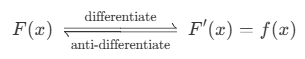
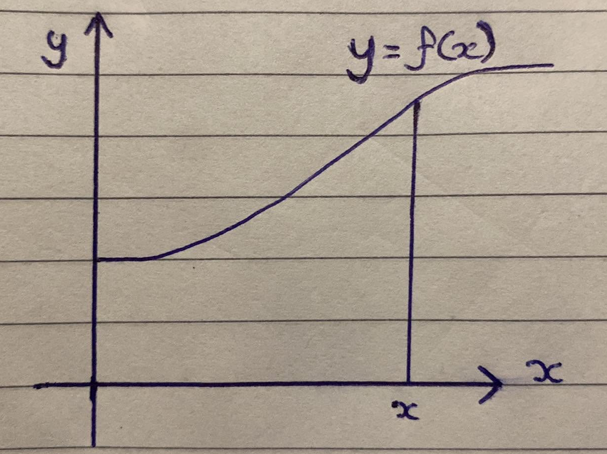
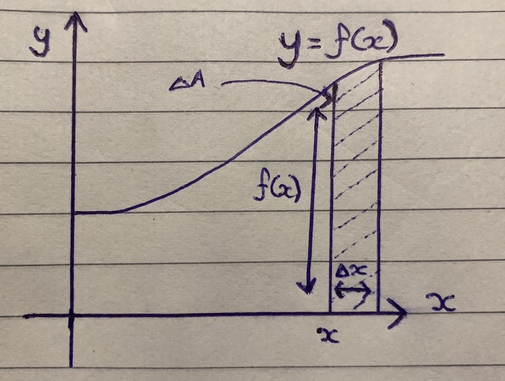
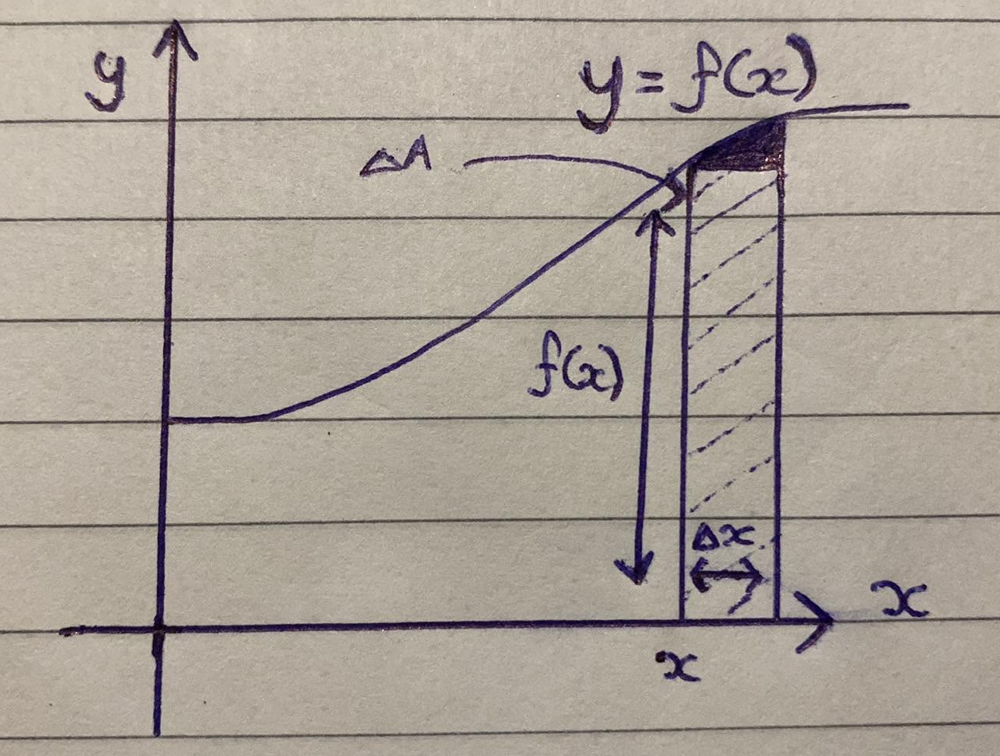
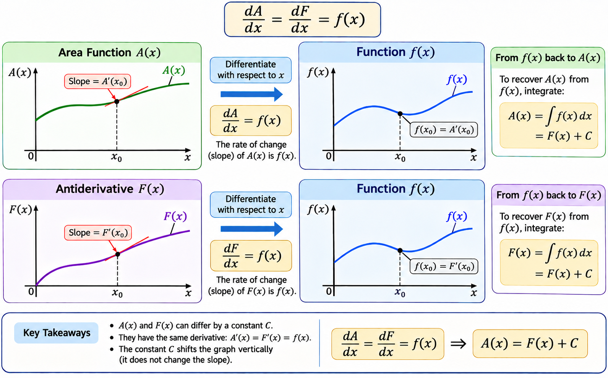
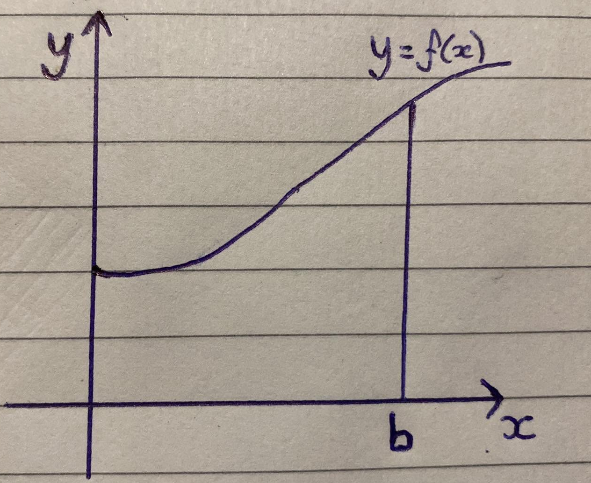
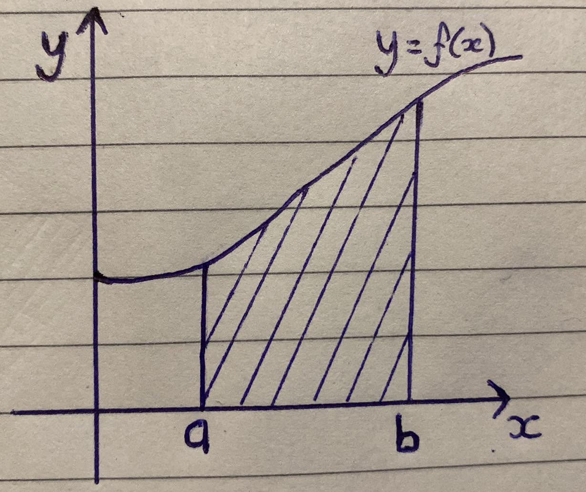
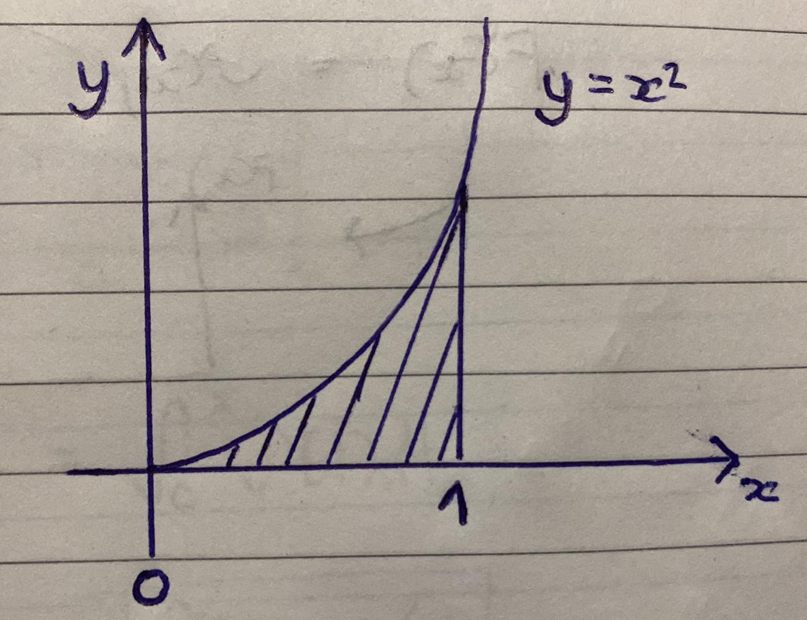

<div align='center'>
    <h1> Fundamental Theorem of Calculus Step by Step </h1>
</div>
 
Before this proof begins, the functions used throughout this proof must be expressed. Where,

- $f(x)$ is the derivative of $F(x)$, where $f(x) = \frac{dF}{dx}$
- $F(x)$ is the antiderivative of $f(x)$

<div align='center'>
    
</div>

Integration is generally introduced as the process of summation of tiny parts. Here, the concept of an integral is defined in terms of the sums of lots of rectangular areas under a curve. To calculate an integral you need to find the limit of a sum. This is a very cumbersome and impractical process. What this approach is defining is the Fundamental Theorem of Calculus where we find the integrals, not by finding the limit of a sum, but instead using anti-derivatives.

Suppose we have a function,

```math
F(x) = 3x^2 + 7x - 2
```

It therefore follows,

```math
F'(x) = f(x) = 6x + 7
```

We are provided $f(x)$ and $F(x)$ is unknown in these situations. If we are to find the antiderivative of $f(x)$, it would be,

```math
F(x) + C
```

This holds because differentiating $F(x)$ removes the constant $-2$. Therefore, any constant $C$ in the equation

```math
F(x) = 3x^2 + 7x + C
```

all differentiate to $f(x)$.

We are going to consider functions which lie entirely above the $x$ axis and also to the right of the $y$ axis. Now, we need to ask ourselves, what is the area under the graph of $y = f(x)$?

<div align='center'>
    
</div>

We define $A$ as the area under the curve $y = f(x)$, when given $x$, will output the area under the curve upto $x$. This is denoted

```math
A = A(x)
```

This shows the dependence of the area upon the value that we choose for $x$. Hence, larger $x$, larger area and smaller $x$, smaller area. There are multiple attributes that are required to be understood,

1. **$f(x)$** - Represents the height at point $x$.
2. **$\Delta x$** - Represents a small distance from $x$.
3. **$\Delta A$** - Represents a small change in area, which has been added from $\Delta x$, shown by the shaded area.

<div align='center'>
    
</div>

We will now attempt to write an expression for $\Delta A$ in an attempt to calculate it. **We cannot calculate it exactly**. The height is calculated using $f(x)$ and the width from $\Delta x$. If we treat this as a rectangle, it can be calculated as $f(x) \cdot \Delta x$. This calculation will ignore the area highlighted above rectangle and is therefore, not exact. Because of this, the equality symbol $=$ cannot be used.

<div align='center'>
    
</div>

Calculating $\Delta A$ will give us,

```math
\Delta A \approx f(x) \Delta x
```

This is only an approximation, denoted using $\approx$. Now, divide both sides by $\Delta x$.

```math
\frac{\Delta A}{\Delta x} \approx f(x)
```

To make this more accurate we need to make $\Delta x$ smaller, this will decrease the width of the rectangles and therefore decrease the amount of area that is missed when using rectangles. Hence, what we want to do is make $\Delta x$ smaller and smaller. This is done using limits.

```math
\lim_{\Delta x \to 0} \frac{\Delta A}{\Delta x}
```

Where, $\Delta A = A(x + \Delta x) - A(x)$. When this is done, the approximation becomes exact because we're calculating a limit value. This limit value represents what the function converges to as $\Delta x$ gets closer and closer to $0$.

```math
\lim_{\Delta x \to 0} \frac{\Delta A}{\Delta x} =
\lim_{\Delta x \to 0} f(x)
```

Since $f(x)$ does not depend on $\Delta x$, it is treated as a constant with respect to the limit.

```math
\lim_{\Delta x \to 0} f(x) = f(x)
```

When we calculate a limit, we can change our approximation $\approx$ to an exact limit value calculation. This now allows us to use the equality symbol $=$ instead of our approximation symbol $\approx$. What we observe here is the definition of derivatives. That is,

```math
\lim_{\Delta x \to 0} \frac{\Delta A}{\Delta x} = \frac{dA}{dx} = f(x)
```

We have established that,

```math
\frac{dA}{dx}=f(x)
```

Interestingly, we already know that $F(x)$ is an antiderivative of $f(x)$, meaning that its derivative is also $f(x)$. The following diagram illustrates the relationship between the area function $A(x)$, the antiderivative $F(x)$, and the original function $f(x)$.

<div align='center'>
    
</div>

As illustrated, both $A(x)$ and $F(x)$ have the same derivative, $f(x)$. Therefore, they can only differ by an arbitrary constant.

Our objective is to find an expression for the area function $A(x)$. Currently, we know its derivative, but we want to recover the original function. To do this, we need to reverse the process of differentiation. This is achieved through integration.

We can integrate both sides of the equation with respect to $x$.

```math
\int \frac{dA}{dx}\,dx = \int f(x)\,dx
```

On the left-hand side, integration reverses differentiation, allowing us to recover the original function $A(x)$. On the right-hand side, integration gives us the antiderivative of $f(x)$.

```math
A(x) = F(x) + C
```

It is important to understand that the area function $$A(x)$$ and the antiderivative $$F(x)$$ are not necessarily the same function. They can differ by an arbitrary constant while still having the same derivative. For example, consider the following two functions,

```math
\begin{aligned}
A(x)&=x^2 \\
F(x)&=x^2-5
\end{aligned}
```

Although these are different functions, differentiating both gives the same result:

```math
A'(x)=2x
```

```math
F'(x)=2x
```

Therefore, both functions have the same derivative, but they differ by a constant of $5$.

```math
A(x)=F(x)+5
```

This is why we express the relationship as

```math
A(x)=F(x)+C
```

rather than assuming that

```math
A(x)=F(x)
```

When calculating a definite integral, this difference does not matter because the constant cancels when we subtract the values at the two endpoints. This is why we can use any antiderivative of $$f(x)$$ to calculate a definite integral.

Where $F(x)$ is an antiderivative of $f(x)$ and $C$ is an arbitrary constant of integration. The constant is necessary because differentiation removes constants. Consequently, integrating a derivative cannot tell us which particular constant was present in the original function.

We have therefore established that the area function $A(x)$ is an antiderivative of $f(x)$ and can be expressed as,

```math
\boxed{A(x)=F(x)+C}
```

We have now established that the area function $A(x)$ can be expressed as $F(x)+C$, where $F(x)$ is an antiderivative of $f(x)$. This tells us that we can recover the general expression for the area function by finding an antiderivative of $f(x)$. However, we still have an unknown constant $C$, which we need to determine before we can express the accumulated area precisely.

We can determine this constant by considering the area function when \(x=0\).

```math
\begin{aligned}
A(x) &= F(x) + C \\
0 &= F(0) + C \\
C &= -F(0)
\end{aligned}
```

This gives us,

```math
A(x) = F(x) - F(0)
```

We can express the area from $0$ to $b$.

```math
A(b) = F(b) - F(0)
```

<div align='center'>
    
</div>

We can now do two things.

1. Add another variable $a$, such that $a < b$
2. We can also calculate the area from $0$ to $a$ using $F(a) - F(0)$

We now have two expressions.

1. The area upto $b$
2. The area upto $a$

We can now calculate the area from $a$ to $b$ by first calculating the area to $b$ and subtracting the area to $a$. Therefore the area under $y = f(x)$ from $x=a$ to $x=b$ is,

```math
F(b) - F(0)- F(a) + F(0) = F(b) - F(a)
```

This is exactly the definition of integration, finding the area from $a$ to $b$. This is expressed using the notation

```math
\int^b_a f(x) \ dx = F(b) - F(a)
```

Where $F$ is any antiderivative of $f$. This explains why precisely we can use any family of an antiderivative because the constant $F(0)$ is removed.

<div align='center'>
    
</div>

Previously, the area under a curve was expressed as a summation given by

```math
A = \sum_{i=1}^{n} f(x_i^*)\,\Delta x = \int^b_a f(x) \ dx
```

This Riemann sum is a definition of the definite integral. If we wanted to calculate it using this method, we would have go to through the process of finding the limit of a sum. The process of finding the limit of a sum is cumbersome and impractical. What we have learnt now is that **we do not need to find the limit of the sum to find the area, we can use these antiderivatives**. We can pull all of this together to finally create,

```math
\int^b_a f(x) \ dx = F(b) - F(a)
```

This means we can define the definite integral from $a$ to $b$ as evaluating the expression $F(b) - F(a)$ where $F$ is an antiderivative of $f$. This solutions only works if the hypotheses conditions are true, which is that the function $f$ is continuous between $a$ and $b$.

As a quick example, we can graph $y = x^2$ and find the area between $a = 0$ and $b = 1$.

```math
\begin{aligned}
f(x) &= x^2 \\
F(x) &= \frac{x^3}{3} + C \\
F(1) &= \frac{1}{3} + C \\
F(0) &= \frac{0}{3} + C = C \\
\end{aligned}
```

Therefore,

```math
F(1) - F(0) = \frac{1}{3} + C - C = \frac{1}{3}
```

The formal notation for this is,

```math
\int^1_0 x^2 \ dx = \left[ \frac{x^3}{3} \right]^1_0 = \frac{1}{3} - \frac{0}{3} = \frac{1}{3}
```

<div align='center'>
    
</div>
